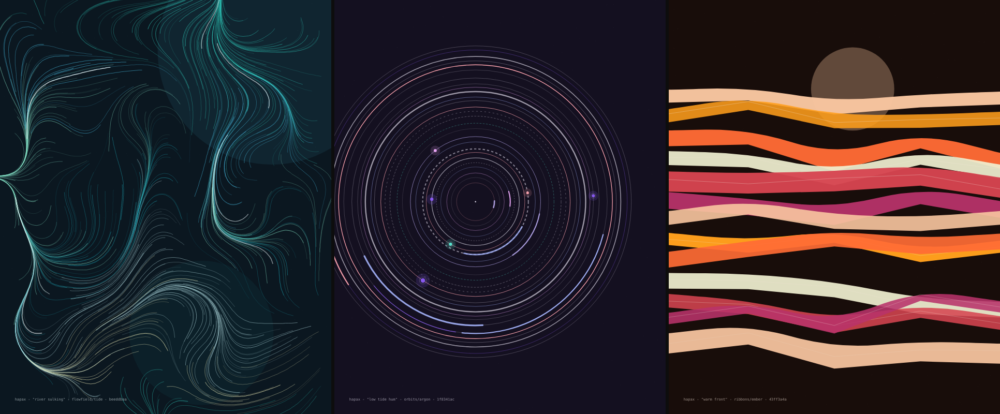
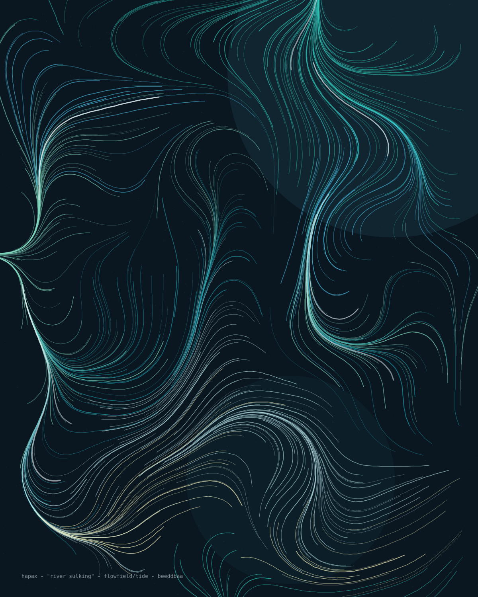
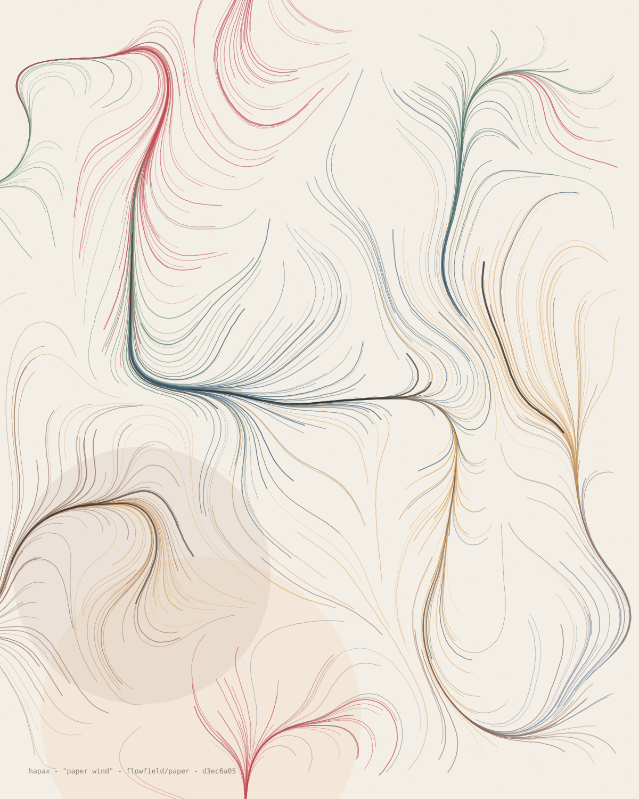
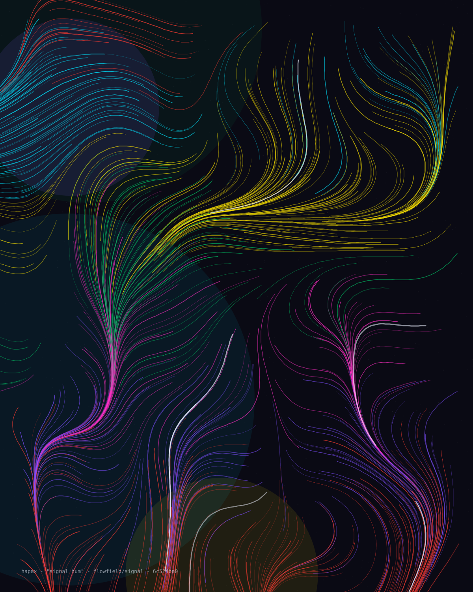
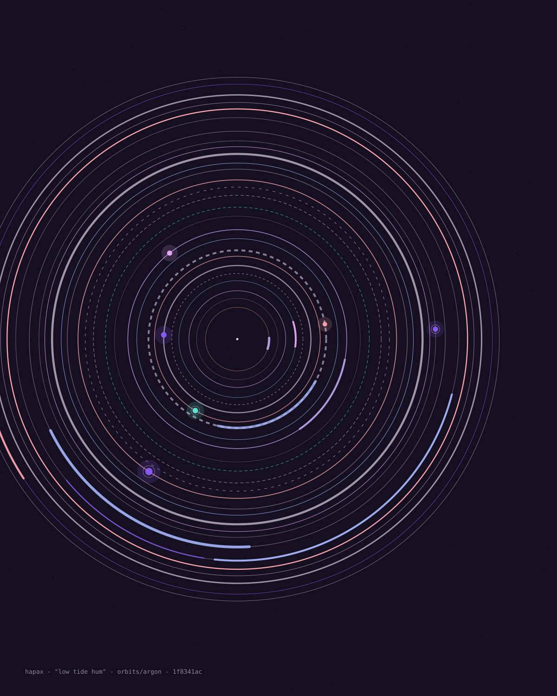
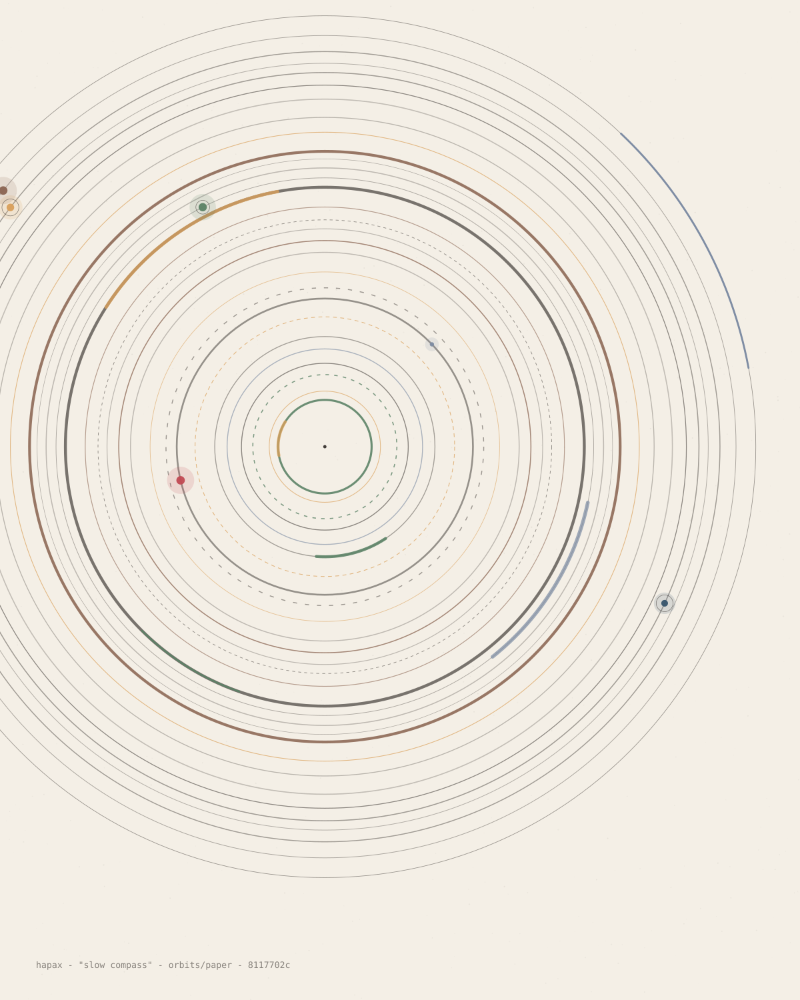
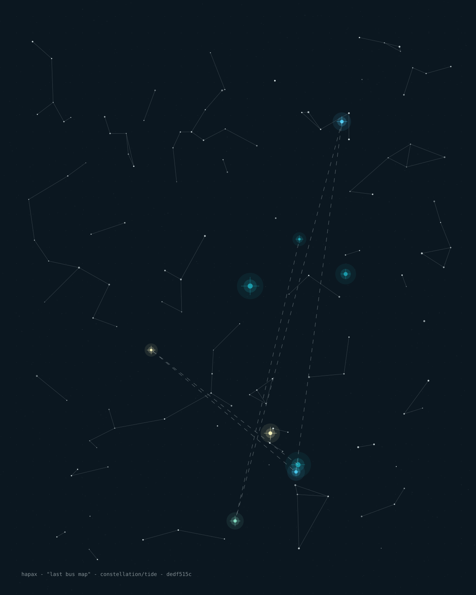
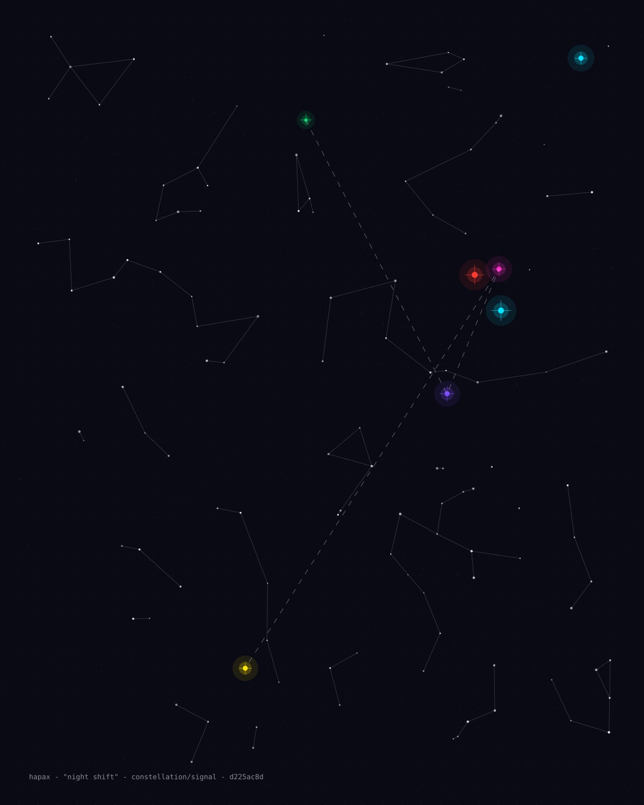
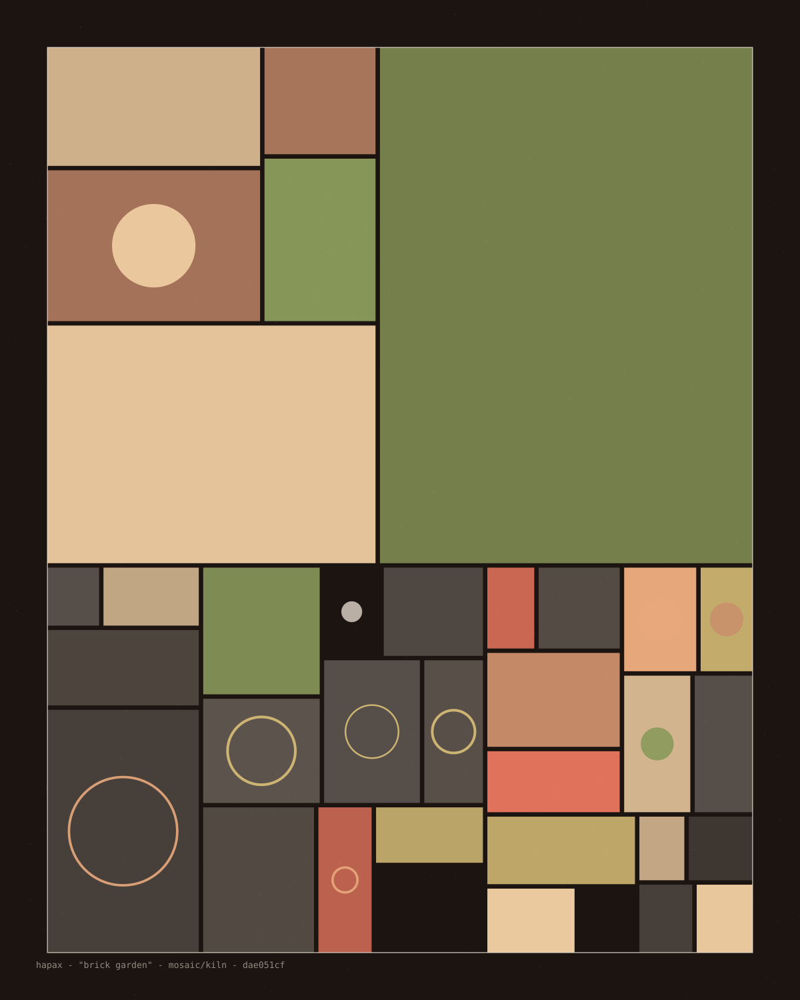
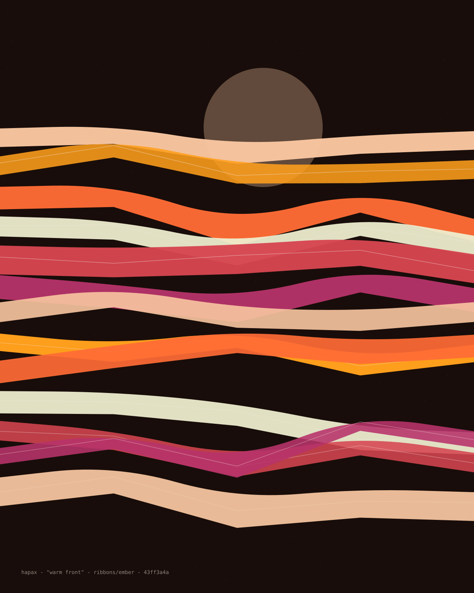

<div align="center">

# hapax

### every seed is a one-of-one poster

deterministic generative SVG art from any phrase — pure Python, **zero dependencies**

[](#) [](#) [](#) [](#) [](LICENSE)



*left to right: `river sulking` · `low tide hum` · `warm front` — all three live in [`gallery/`](gallery)*

</div>

---

Type any phrase and hapax turns it into a **poster**: a deterministic, resolution-independent
SVG you can print, pin, or set as a wallpaper. The same phrase always produces the same
poster — byte for byte, on any machine, forever. Change one character and you get a
completely different artwork that has never existed before and will never be generated
again. That is why it is called *hapax* — from **hapax legomenon**, a word that occurs
only once in a corpus.

There is no neural network here and no randomness that escapes you. Every "artistic
decision" — the algorithm, the palette, the composition, the grain — is derived from the
SHA-256 of your phrase through domain-separated random streams. The poster is not stored;
it is *recomputed* from the seed each time, which means a poster is just its phrase.

## quick start

```bash
git clone https://github.com/limitlessprojects/hapax.git
cd hapax
python hapax.py "a quiet machine"        # -> hapax-67dead9f.svg
```

That is the whole install. No pip, no venv, no build step — one file and the Python
you already have. Open the SVG in any browser.

```bash
python hapax.py "torvalds" --style orbits --palette kiln     # pin the look
python hapax.py "sunday" --size 1920x1080                    # wallpaper, wide
python hapax.py "my saves" --sheet 12                        # 12 posters, one folder
python hapax.py --list                                       # see all styles/palettes
```

Omit the seed and hapax invents one and prints it back to you, so nothing is ever lost:

```bash
$ python hapax.py
hapax-3f9c21ab.svg  [mosaic/pastelex]  seed='untitled-4e81c2'
```

## five algorithms

Every poster is one of five hand-built drawing systems. `--style auto` lets the seed choose.

### flowfield

Thousands of particles advected through a seeded value-noise field, drawn as tapered
ink strands over soft color washes. The signature style.

| | | |
|---|---|---|
|  |  |  |
| `"river sulking"` | `"paper wind"` | `"signal hum"` |

### orbits

Concentric ring systems with dashed tracks, arc highlights and glowing planets —
somewhere between an astronomical chart and a vinyl record.

| | |
|---|---|
|  |  |
| `"low tide hum"` | `"slow compass"` |

### constellation

A scatter of stars joined by proximity edges, with bright named stars, halos and a
dashed sightline route. Faint survey grid underneath.

| | |
|---|---|
|  |  |
| `"last bus map"` | `"night shift"` |

### mosaic

Recursive rectangle subdivision with weighted fills, circle interrupts and ink leading —
the poster behaves like a glazed tile wall.

| |
|---|
|  |
| `"brick garden"` |

### ribbons

Layered cloth bands draped across the frame over a low sun — the loudest style.

| |
|---|
|  |
| `"warm front"` |

## twelve palettes

`--palette auto` picks one from the seed, or pin one by name:

`argon` `kiln` `tide` `ember` `orchard` `monsoon` `candy` `noir` `paper` `signal` `moss` `pastelex`

Each palette carries a background, an ink and six accents, tuned to work on dark *and*
light ground — `candy`, `paper` and `pastelex` print on light, the rest glow on dark.

## CLI reference

```
usage: hapax.py [-h] [-o OUT] [--style STYLE] [--palette PALETTE]
                [--size WxH] [--sheet N] [--no-grain] [--no-caption]
                [--list] [--quiet] [seed]

positional:
  seed                 any phrase; omit one to get a fresh random seed

options:
  -o, --out PATH       output path (default: hapax-<hash8>.svg)
  --style              auto | flowfield | orbits | mosaic | ribbons | constellation
  --palette            auto | argon kiln tide ember orchard monsoon
                             candy noir paper signal moss pastelex
  --size WxH           default 1200x1500 (4:5 poster)
  --sheet N            render N posters seeded "<seed> #1..N" into a folder
  --no-grain           skip the film-grain texture pass
  --no-caption         skip the edition caption
  --list               list styles and palettes
  --quiet              print nothing
```

Every poster carries a small **edition caption** — the seed, the style/palette and an
8-hex fingerprint — so any print can always be traced back to the exact phrase that
made it.

## how determinism works

One phrase goes in; five independent decisions come out. hapax hashes the seed with a
**domain tag** into each subsystem, so the palette stream never knows what the layout
stream is doing and tweaking one style never reshuffles the others:

```python
def rng_for(seed, domain):
    h = hashlib.sha256(seed.encode() + b"\x1f" + domain.encode()).digest()
    return random.Random(int.from_bytes(h, "big"))

rng_for(seed, "choose-style")     # which algorithm
rng_for(seed, "choose-palette")   # which palette
rng_for(seed, "style:ribbons")    # that algorithm's entire layout
rng_for(seed, "grain")            # the grain pass
```

The RNG is Python's Mersenne Twister, seeded once per domain — and since the whole
poster is a pure function of `(seed, style, palette, size, grain, caption)`, the SVG you
generate today is the SVG someone regenerates in ten years. The test suite asserts
byte-equality across processes to prove it.

## printing

SVG scales losslessly to any size. For paper:

```bash
# to PNG at 300 DPI (any of: resvg, inkscape, rsvg-convert, or just a browser screenshot)
resvg --width 3600 hapax-67dead9f.svg poster.png
```

For screens, generate at native resolution with `--size 1920x1080` (desktop) or
`--size 1170x2532` (phone) — everything in hapax is drawn relative to the canvas.

## license

MIT — see [LICENSE](LICENSE). The tool is yours; every poster it makes is yours too.
